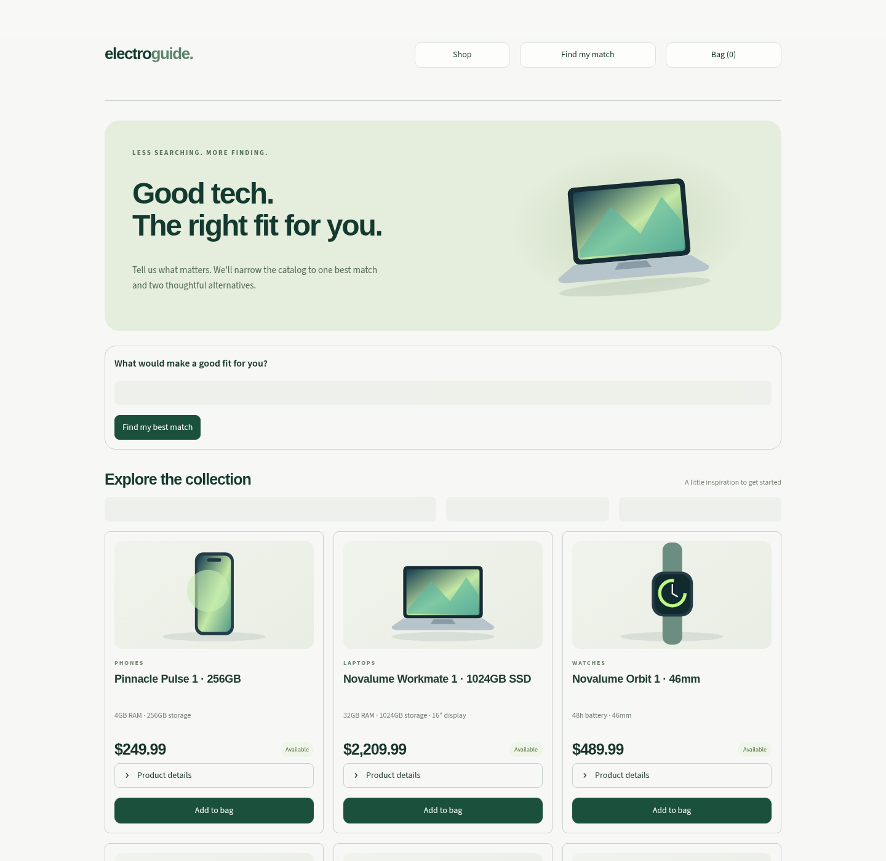
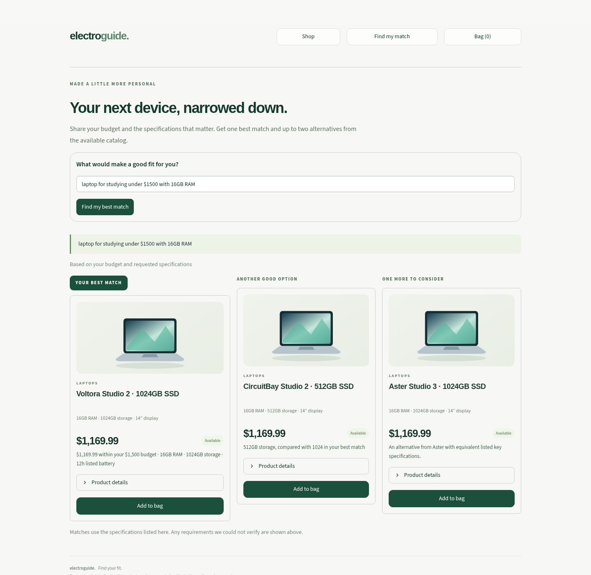

# ElectroGuide

A minimal electronics storefront for an MS project: browse products, describe what you need, and see **one best catalog match plus up to two alternatives**.





## Run on Windows / VS Code

Open the folder containing `streamlit_app.py` in VS Code, then run these commands one at a time:

```powershell
py -m venv .venv
.\.venv\Scripts\python.exe -m pip install -r requirements.txt
.\.venv\Scripts\python.exe -m streamlit run streamlit_app.py
```

Open http://localhost:8501. Stop an older running server with Ctrl+C before starting the new version. [Full Windows guide](docs/WINDOWS_STREAMLIT.md).

## Customer experience

Three top navigation buttons: **Shop**, **Find my match**, and **Bag**. No sidebar, compare, wishlist, dashboard, or connection settings in the customer interface. The shop has a short discovery form and a searchable, paginated collection. The finder returns at most three distinct catalog configurations, with factual specification/price reasons; the bag supports a clearly labeled simulated checkout. The bag and local demo checkout use session state. Optional Salesforce draft orders have a local receipt ledger.

Try: `A laptop for studying under $1500 with at least 16GB RAM`.

## Salesforce product-catalog integration (selected path)

[Start here: Product2 setup, API check, import and sync](docs/SALESFORCE_CATALOG.md).

This path does not require a Commerce store. A standard [100-product CSV](imports/salesforce/product2-100.csv?raw=true), Product2 API access check, owner import command (skip existing codes by default), and read/snapshot connector are included. The existing Streamlit shop and semantic finder can use the synced Product2 catalog. All Salesforce responses have been tested with mocks; API access and a live import in the user's Starter trial remain unverified.

For the observed INR org, USD demo prices are explicitly stored in Description metadata; INR price-book values are never silently relabeled as dollars. Native USD price-book snapshots are an optional separately verified mode. Availability and checkout remain simulated.

The earlier [Lightning D2C Commerce-store guide](docs/LIGHTNING_D2C_IMPORT.md) is retained as an optional future path; it is not required for Product2 integration.

For the full catalog, [import and sync 50,000 Product2 records](docs/SALESFORCE_50000.md) with storage/API preflight, 200-record REST batches, progress, and rerun support. [Download the full Product2 ZIP](imports/salesforce/product2-50000.csv.zip?raw=true).

## Where OpenAI and Salesforce are used

| Component | Current role | Current limitation |
| --- | --- | --- |
| Local catalog | Supplies the storefront and all product recommendations | 50,000 fictional SKUs; prices, stock, and specifications are synthetic |
| OpenAI API key | Server-side calls interpret requests, embed catalog/query text for semantic retrieval, and explain the selected products | Optional; requires a valid locally configured replacement key and billing/model access. Without it, specification-based matching still works and is labeled accordingly |
| Salesforce Product2 catalog | Standard product records read through platform OAuth/REST, then synced into the shop and semantic finder | Requires API entitlement and local OAuth configuration; no Commerce store needed. Demo USD pricing/stock by default |
| Lightning D2C Commerce | Optional legacy store-based import/snapshot connector | Not required by the selected catalog-only project path |
| Salesforce B2C Commerce | Separate legacy read-only SCAPI diagnostic | Not applicable to the user’s Lightning D2C setup |

The app defaults to its local demo catalog. After a successful Product2 import and sync, set `CATALOG_SOURCE="salesforce_catalog_snapshot"`. The owner connector preserves Salesforce IDs and supplies the existing recommendations. No public shopper authorization, real inventory, or native Commerce checkout is claimed.

## Matching behavior

[Enable semantic search and requirements comparison](docs/SEMANTIC_SEARCH.md). Build the local embedding index once with `python -m scripts.build_semantic_index`; embeddings use your OpenAI account. A no-cost `--dry-run` reports the document count.

Category, budget, in-stock status, and supported requested specifications are hard filters. Supported specifications include minimum RAM, storage and battery hours, exact screen size, resolution, listed noise cancellation, and available fictional brand. When an embedding index and key are available, eligible products are ranked using OpenAI query/catalog cosine similarity, feature/price signals, and keyword overlap. Otherwise a labeled feature/price fallback is used. Alternatives favor different specifications. A collapsible factual table compares the selected products against the shopper’s requirements.

The LLM can extract requirements but cannot override explicitly parsed budget/spec constraints. Final cards and prices come from actual catalog records. Known unsupported requirements are flagged. If no records qualify, no product is invented and constraints are not silently relaxed. The first card is a **best catalog match under this heuristic**, not a guaranteed best real-world product. Real-brand requests cannot be satisfied by the fictional catalog. Learned personalization and a comprehensive natural-language constraint engine remain future work. Semantic ranking weights are initial experimental settings; live embedding relevance has not been evaluated here. Generated explanations should be verified against the displayed facts.

## Configure credentials locally

Copy `.streamlit/secrets.toml.example` to `.streamlit/secrets.toml` only if your local file does not already exist. Enter a replacement OpenAI key there privately; revoke any key previously posted in chat. Never commit or share the completed file. Environment variables with the same names are also supported. No `.env` file is automatically loaded.

Owner diagnostics have moved out of the storefront:

```powershell
.\.venv\Scripts\python.exe -m scripts.check_connections
```

This explicitly calls OpenAI (which may incur a charge) and the Salesforce search endpoint when their configuration is present, and prints sanitized connection status. No Salesforce password is accepted; B2C SCAPI uses short code, organization ID, site ID, and a valid SLAS shopper access token. Automatic OAuth/token refresh is not implemented.

## Data and checks

[Download the full catalog ZIP](data/electroguide-catalog-50000.zip?raw=true). It contains JSONL, CSV, and a provenance/checksum manifest. Ten categories contain 5,000 synthetic SKUs each. Category illustrations are original local SVG depictions, not manufacturer photographs. The app extracts the bundled v2 catalog and builds its index on first run. Back up manually edited generated data before upgrading.

```powershell
.\.venv\Scripts\python.exe -m unittest discover -s tests -v
```

For the optional standalone lexical API: `python scripts/generate_catalog.py`, `python -m scripts.build_index`, then `python -m app.server`. Streamlit does not require that server.

[Project research plan](docs/PROJECT_PLAN.md) · [Salesforce prerequisites](docs/SALESFORCE_SETUP.md)

No real payments, persistent customer accounts, live inventory synchronization, or native Commerce checkout are implemented. Optional standard Salesforce draft Order/OrderItem records can be created after setup; their Salesforce-generated order number is displayed in the storefront.

[Set up matching Salesforce and Streamlit order numbers](docs/SALESFORCE_ORDERS.md).

[Sync Salesforce product Media images into the storefront](docs/SALESFORCE_IMAGES.md).
