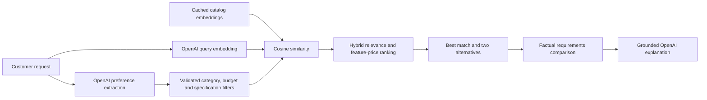

# Semantic search and requirements comparison

## Enable it on your computer

1. Download the current project and open the folder containing `streamlit_app.py` in VS Code.
2. Configure `.streamlit/secrets.toml` locally. Values must be quoted TOML strings:

```toml
OPENAI_API_KEY = "YOUR_OPENAI_KEY"
OPENAI_MODEL = "gpt-4o-mini"
OPENAI_EMBEDDING_MODEL = "text-embedding-3-small"
OPENAI_EMBEDDING_DIMENSIONS = "512"
```

An existing `api_key = "..."` field is accepted as a compatibility alias, but `OPENAI_API_KEY` is preferred. Do not put a key in Python source or GitHub. Do not paste it into a terminal command. The ignored local secrets file is not encrypted; keep it private.

3. Install requirements, then generate the index once:

```powershell
.\.venv\Scripts\python.exe -m pip install -r requirements.txt
.\.venv\Scripts\python.exe -m scripts.build_semantic_index --dry-run
.\.venv\Scripts\python.exe -m scripts.build_semantic_index
.\.venv\Scripts\python.exe -m streamlit run streamlit_app.py
```

If `.venv` does not exist, first run `py -m venv .venv`. Stop any older app with Ctrl+C before launching the updated version.

The dry run makes no external calls. The actual build sends product descriptions to OpenAI and incurs embedding usage. The bundled 50,000-SKU catalog has **1,760 distinct descriptive documents** under the current document schema; identical descriptions share vectors while retaining their individual product IDs, prices, and stock. Prices/stock are not embedded because they are hard constraints and change independently. This count was checked locally without a paid API call. No live OpenAI quality or account-access test has been performed in this workspace.

The build saves `data/semantic.sqlite` (ignored by Git). Each successful batch is committed, so rerunning the same command after interruption reuses completed vectors. Changing the embedding model or dimensions requires vectors for that configuration. Changed descriptions get new content hashes; unchanged vectors are reused. Changing only price/stock does not require re-embedding, but the local commerce catalog must separately be kept current.

## Request flow



Hard requirements are enforced before semantic ranking: category, price ceiling, stock, requested RAM/storage/battery minimums, exact screen size/resolution, listed noise cancellation (including explicit exclusion), color, and available fictional brand. Real manufacturer requests and known unverified capabilities are flagged. Ambiguous requests can still require clarification; this is not a comprehensive natural-language constraint solver.

Eligible document vectors and the query vector are normalized, and cosine similarity is computed with NumPy. The hybrid rank uses **70% normalized cosine similarity, 20% normalized feature/price heuristic, and 10% token overlap**. These are initial experimental weights, not a learned ranking model. There is no calibrated similarity threshold or confidence percentage. Rank respects the hard constraints; it cannot substitute a more expensive or out-of-stock product. Where possible, alternatives use different specification configurations before equivalent configurations from other fictional brands.

The requirements comparison is built directly from selected catalog records and validated intent. It compares requested budget/specifications with each of the three options; OpenAI does not generate the table values. Unsupported requirements remain separate notes. A concise optional explanation receives only the selected products and their comparison context. Model prose is still generated and must be verified against the cards/table.

## Fallback behavior

If the index is missing/incomplete, the embedding model/dimensions differ, descriptions are stale, the key is missing, or a provider request fails, the finder uses its specification/feature-based fallback. It labels results as semantic only when vector retrieval actually succeeded. Owner diagnostics:

```powershell
.\.venv\Scripts\python.exe -m scripts.check_connections
```

If no products satisfy hard constraints, the app returns no products instead of relaxing them or paying for a query embedding. Reruns caused by bag/navigation actions reuse the stored result and do not repeat API calls.

## Implemented files

- `app/semantic.py`: embedding API, content hashes, normalized vectors, SQLite cache, resumable batches, cosine search.
- `scripts/build_semantic_index.py`: owner build/dry-run command.
- `app/shopping.py`: constraints, hybrid ranking, diversity, and factual comparison.
- `app/integrations.py`: preference extraction and grounded explanations.
- `streamlit_app.py`: the existing minimal storefront and a collapsible “How these match your request” table.

## Current limits

The catalog is synthetic. The weights and live embedding relevance have not been academically evaluated. This implementation retrieves product records; policy-document vector retrieval, learned personalization, real reviews/performance verification, and automatic Salesforce synchronization are not implemented. Salesforce remains an independent read-only diagnostic, not the source of storefront inventory or orders. The vector cache is for a local academic app, not a multi-tenant production vector service.
